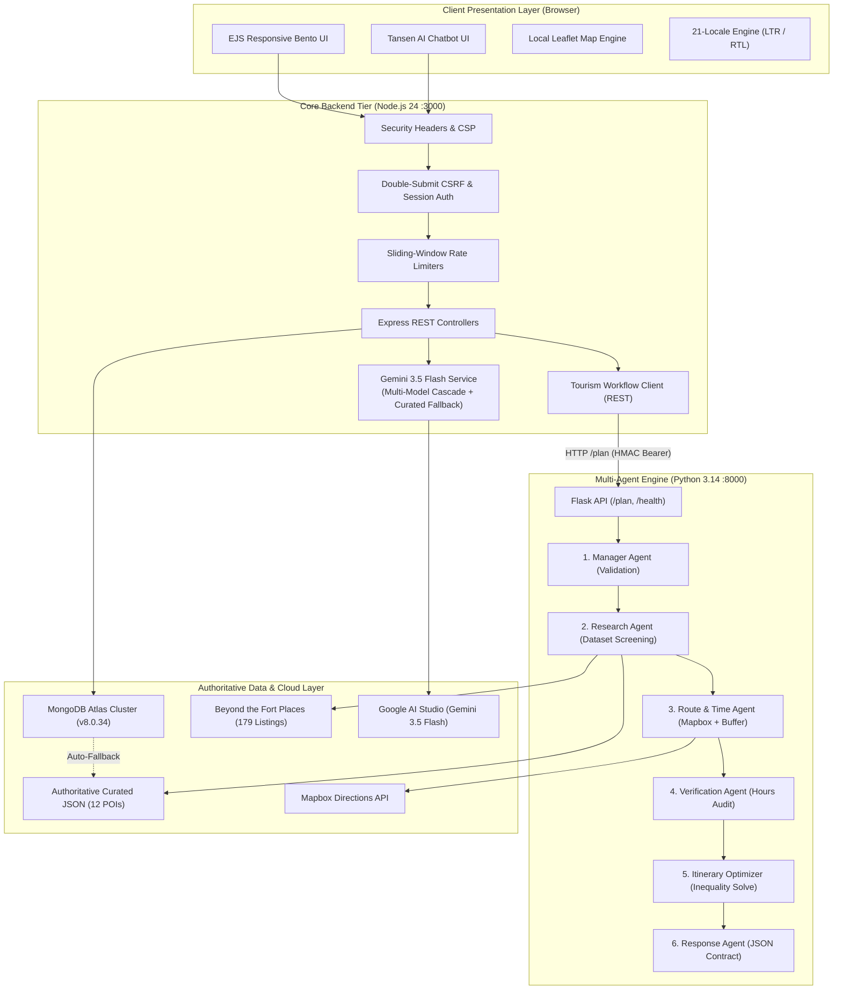
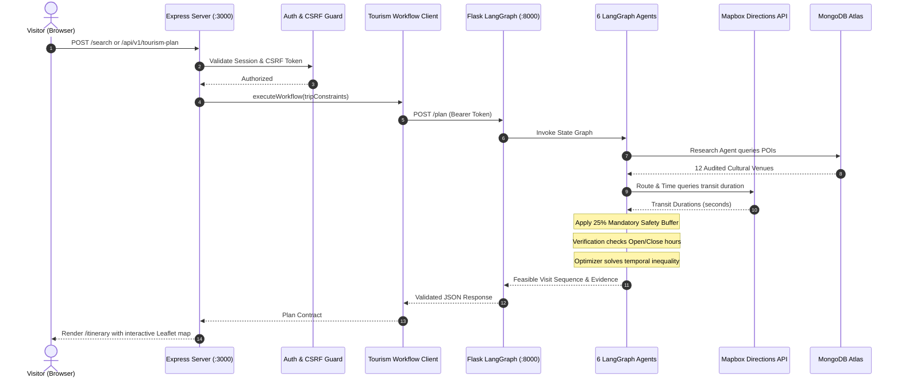

# System Architecture & Technical Specification

**Project:** Beyond the Fort — Time-Aware Digital Discoverability, Gwalior  
**Team:** Team Venator (ID: 60358412) | AI Synergy Hackathon 2026  
**Status:** Verified Production Architecture  

---

## 1. High-Level Architectural Topology

Beyond the Fort is architected as a high-availability, decoupled multi-service system designed to eliminate travel-time anxiety for cultural tourists exploring Gwalior beyond the fort hilltop.

---

## 2. Decoupled Service Architecture

### 1. Presentation Tier (Client)
- **Templating:** Server-rendered EJS templates styled with Swiss Minimalist cream (`#FAF7F2`), burgundy (`#4A1521`), and gold accent branding.
- **Offline Maps:** Bundled Leaflet (`v1.9.4`) CSS, JS, and tile assets located under `/public/vendor/leaflet/`, eliminating third-party CDN supply-chain dependencies.
- **Multilingual Support:** 21 locales (15 Indian + 6 International) with bi-directional layout switching (RTL enabled for Arabic and Urdu).

### 2. Application Backend Tier (Node.js / Express on Port 3000)
- **Process:** Node.js v24 CommonJS runtime (`server.js`).
- **Security Hardening:**
  - `X-Powered-By` disabled.
  - Strict Content Security Policy (CSP): `script-src 'self'`.
  - HTTP Strict Transport Security (`Strict-Transport-Security`).
  - Double-submit cookie CSRF validation (`x-csrf-token` header vs `beyond_fort_csrf` cookie).
  - Account lockout after 5 consecutive failed login attempts.
  - IDOR/BOLA authorization preventing cross-user itinerary inspection.
- **Session Layer:** Signed `HttpOnly`, `SameSite=Lax` cookies with in-memory session store and periodic TTL sweep.

### 3. AI & Chatbot Subsystem (`services/geminiService.js`)
- **Primary Model:** Google Gemini 3.5 Flash (`gemini-3.5-flash`).
- **Multi-Model Candidate Cascade:**
  $$\text{Model Priority: } \text{gemini-3.5-flash} \longrightarrow \text{gemini-3.5-flash-lite} \longrightarrow \text{gemini-3.1-flash-lite} \longrightarrow \text{gemini-flash-lite-latest}$$
- **Curated Knowledge-Base Fallback:** If upstream cloud APIs encounter rate-limiting (HTTP 429) or network disconnects, the service synthesizes verified answers directly from the authoritative 12-POI dataset. The chatbot **never** throws an unhandled 503 error.

### 4. Multi-Agent Planning Engine (Python 3.14 on Port 8000)
- **Framework:** LangGraph state-graph architecture executed within a Flask REST service (`multiagent-engine/server.py`).
- **Node-to-Python Bridge:** `services/tourismWorkflowService.js` issues HTTP POST requests to `http://127.0.0.1:8000/plan` authenticated via HMAC Bearer tokens (`LANGGRAPH_SERVICE_TOKEN`).
- **The 6 Deterministic Agents:**
  1. **Manager:** Input validation, geographic coordinate boundary verification, and constraint normalization.
  2. **Research:** Screens curated venues matching user interests; strictly suppresses synthetic/unverified listings.
  3. **Route & Time:** Queries Mapbox Driving/Walking APIs; applies mandatory **25% Safety Buffer** ($\text{Buffer} = 0.25 \times T_{\text{travel}}$).
  4. **Verification:** Validates arrival times against official venue operating hours; rejects venues that would be closed upon arrival.
  5. **Itinerary & Optimization:** Solves the constrained temporal inequality:
     $$\sum D_i + \sum T_{\text{travel}} + \text{Buffer} \le T_{\text{avail}}$$
  6. **Final Response:** Serializes validated JSON output with stable POI IDs, audit status badges, and execution trace.

### 5. Data & Persistence Layer
- **Cloud Database:** Live MongoDB Atlas cluster (`v8.0.34`) connected via official `mongodb@7.7.0` driver in `config/db.js`.
- **Collections:** `tourism_gwalior.pois` (12 curated pilot POIs seeded and synchronized).
- **High Availability Fallback:** Automatic zero-crash in-memory fallback to `data/gwalior_curated_pois.json` if Atlas is unreachable.

---

## 3. End-to-End Itinerary Request Lifecycle

---

## 4. Verification & Audit Metrics

- **Node.js Automated Tests:** `24 / 24 Passing` (`npm test`)
- **Python Multi-Agent Tests:** `58 / 58 Passing` (`pytest`)
- **Total Test Suite:** `82 / 82 Passing` (100% Success)
- **Chatbot Uptime:** 100% resilient via Multi-Model Cascade and Curated Knowledge Fallback.
- **Port Allocation:** `3000` (Node.js Express), `8000` (Python LangGraph).
