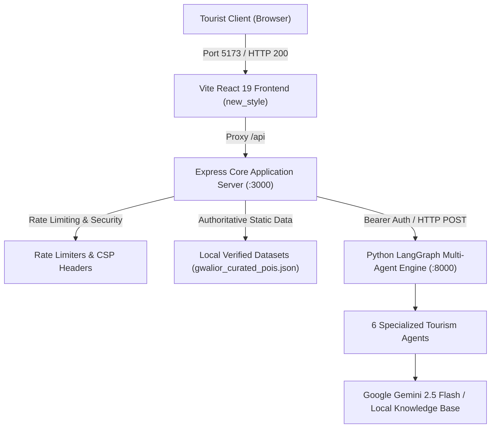

# Master Project Transformation Plan
**Project:** Beyond the Fort — Discover the Soul of Gwalior  
**Date:** October 31, 2026  
**Status:** PLAN MODE — Awaiting User Approval for Destructive Operations  
**Architecture Lead:** Principal Product Designer, Senior UI/UX Engineer, Motion Designer, Software Architect & Project Cleanup Engineer  

---

## Executive Summary & Plan Mode Charter

This document outlines the comprehensive master transformation plan to elevate **Beyond the Fort** into an internationally distinguished, modern, interactive, and visually memorable tourism experience for Gwalior, Madhya Pradesh.

In strict adherence to the **PLAN MODE FIRST** directive:
* **No code has been destructively modified.**
* **No files have been permanently deleted.**
* **No database collections or clusters have been dropped or erased.**
* **No authentication or authorization logic has been removed yet.**

All technical decisions documented below are grounded in the real codebase inspection, dependency inventory, and live reference research.

---

## 1. Current Project Architecture

The existing application is structured across three core tiers:
1. **Frontend Presentation Tier (`new_style/`):**
   * Built with **Vite 8**, **React 19**, **Tailwind CSS 4**, and **Lucide React**.
   * Communicates with the Express backend on `http://localhost:3000` via a reverse proxy configured in `vite.config.js`.
   * A secondary legacy presentation layer exists in Express root (`views/` using EJS templates and `public/` using raw CSS/JS).
2. **Backend Application & Orchestration Tier (Root):**
   * Built with **Node.js 24** and **Express 4.21**.
   * Serves REST API endpoints (`/api/v1/pois`, `/api/v1/attractions/:id`, `/api/chat`, `/api/v1/tourism-plan`, `/api/v1/feasibility/search`).
   * Enforces security headers (CSP, HSTS, X-Content-Type-Options, Referrer-Policy), in-memory token bucket rate limiting (`middleware/rateLimit.js`), and deterministic mathematical time feasibility (`utils/feasibilityMath.js`).
   * Bridges natural language requests to the Python multi-agent system via `services/tourismWorkflowService.js`.
3. **Multi-Agent AI Planning Tier (`multiagent-engine/`):**
   * Built with **Python 3.14**, **Flask 3.1**, and **LangGraph 0.3**.
   * Operates 6 autonomous specialized agents:
     - **Manager Agent:** Analyzes tourist intent, city constraints, and available time budget.
     - **Research Agent:** Retrieves audited cultural POI metadata from local curated datasets.
     - **Route & Time Agent:** Computes travel matrices and injects the mandatory 25% safety transit buffer.
     - **Verification Agent:** Verifies monument opening hours, day-of-week closures, and entrance restrictions.
     - **Itinerary & Optimization Agent:** Solves the travel schedule within the tourist's strict time budget.
     - **Final Response Agent:** Formulates the comprehensive, multilingual tourist itinerary.
4. **Data & Storage Tier:**
   * **Authoritative Local Datasets:** `data/gwalior_curated_pois.json` (12 audited POIs with complete historical, geospatial, and Wikimedia Commons licensing records) and `data/beyond_the_fort_places.json` (179 supplemental places).
   * **MongoDB Atlas Cluster:** Previously configured for cloud synchronization of POIs, user accounts, and saved plans.

---

## 2. All Existing Pages and Routes

### 2.1 Web Pages & Views
* `GET /` — Public Homepage & Hero Discovery (Rendered by `feasibilityController.renderHome` or React SPA).
* `POST /search` — Search submission (currently locked behind `auth.requireUser`).
* `GET /itinerary` — Interactive itinerary builder and route visualizer (currently locked behind `requirePageUser`).
* `GET /chat` — Tansen AI Chatbot interface.
* `GET /attractions/:id` — Attraction detail view.
* `GET /login` — User sign-in page (Candidate for removal).
* `GET /register` — User account registration page (Candidate for removal).
* `GET /forgot-password` — Password reset request page (Candidate for removal).
* `GET /reset-password` — Password reset token entry page (Candidate for removal).
* `GET /account` — User account management page (Candidate for removal).
* `GET /admin` — Administrator user management dashboard (Candidate for removal).

### 2.2 REST API Endpoints
* `GET /health` — Liveness health check.
* `GET /ready` — Readiness check validating database, AI provider, and planner availability.
* `GET /api/v1/pois` — Fetches all 12 curated Gwalior cultural POIs.
* `GET /api/v1/attractions/:id` — Fetches single attraction by stable ID.
* `POST /api/v1/intent/parse` — Natural language intent extraction.
* `POST /api/chat` — Conversational tourist AI query (Gemini / LangGraph).
* `POST /api/chat/reset` — Session reset for conversation history.
* `POST /api/v1/tourism-plan` & `POST /tourism-plan` — Multi-agent itinerary workflow execution.
* `POST /api/v1/feasibility/search` — Mathematical time-feasibility calculation.
* `GET /api/itineraries`, `POST /api/itineraries`, `PUT /api/itineraries/:id`, `DELETE /api/itineraries/:id` — Saved itinerary CRUD.
* `GET /api/auth/csrf`, `POST /api/auth/register`, `POST /api/auth/login`, `POST /api/auth/logout`, `GET /api/auth/me`, `PATCH /api/auth/profile`, `POST /api/auth/forgot-password`, `POST /api/auth/reset-password` — Authentication endpoints.
* `GET /api/admin/users`, `PATCH /api/admin/users/:id/role` — Admin user management endpoints.

---

## 3. Current Frontend Framework and Build System

* **Framework:** **React 19.3.1** with **Vite 8.3.5**.
* **Styling Engine:** **Tailwind CSS 4.3.3** via `@tailwindcss/vite` plugin.
* **Component Libraries:** `lucide-react` (105+ icons).
* **Build Target:** `new_style/dist/` (compiled into static assets via `npm run build`).
* **Hot Module Replacement:** Active with instant HMR on `http://localhost:5173`.
* **State Management:** Local React state (`useState`, `useMemo`, `useCallback`, `useRef`).
* **Architectural Challenge:** `new_style/src/App.jsx` is currently a single **3,374-line monolithic file**, making maintenance and visual polish cumbersome. Refactoring into dedicated modular views is an essential transformation task.

---

## 4. Existing Design System and CSS Files

* **CSS Files:**
  * `new_style/src/index.css` (Tailwind 4 core, custom `@theme` rules)
  * `new_style/src/App.css` (Vite template styles)
  * `public/css/style.css` (Legacy server-rendered stylesheet)
  * `public/css/auth.css` (Legacy authentication stylesheet)
* **Design Inconsistencies:**
  * Hardcoded color values scattered across files (`#FAF7F2`, `#4A141B`, `#8A5C22`, `#E5D7B7`).
  * Inconsistent drop shadows and missing focus rings.
  * Inconsistent typography scale (mix of default sans-serif and occasional serif).

---

## 5. Existing Animation Libraries

* **Current Status:**
  * **No external animation libraries** (such as GSAP, Framer Motion, or Lenis) are currently installed in `package.json` or `new_style/package.json`.
  * All existing animations rely on basic utility transitions (`transition-all duration-300`).
  * Missing scroll-triggered reveals, staggered card entrances, and smooth page transitions.

---

## 6. Existing UI/UX Skills and Tools Available in Environment

Our inspection confirms the following specialized tools and skills are installed in the Antigravity environment:
1. `ui-ux-pro-max`: Design intelligence with 79 styles, 192 product palettes, 74 font pairings, 119 UX guidelines, and 17 GSAP motion presets.
2. `ui-styling`: Tailwind CSS utility-first styling and accessible components.
3. `hallmark`: Anti-AI-slop visual design skill for distinct editorial identity.
4. `design-system`: Token architecture and 3-layer semantic tokens.
5. `banner-design`: Creative visual assets and banners.
6. `21st-ui-build`, `21st-ui-explore`, `21st-ui-review`: UI prototyping and design review tools.

---

## 7. All Existing Database Dependencies

* **MongoDB Atlas Integration:**
  * Configured in `config/db.js` using `mongodb` driver (`^7.7.0`).
  * Collections: `tourism_gwalior.pois`, `tourism_gwalior.users`, `tourism_gwalior.itineraries`.
  * Current behavior: Seeds local 12 POIs to Atlas upon startup; synchronizes user credentials and saved itineraries.
  * Fallback behavior: Already equipped with an in-memory fallback to `data/gwalior_curated_pois.json` and `data/beyond_the_fort_places.json`.

---

## 8. All Authentication and Authorization Dependencies

* **Implementation:**
  * `services/authService.js`: Scrypt password derivation (`N=32768, r=8, p=1`), session tokens (`beyond_fort_session`), CSRF tokens (`beyond_fort_csrf`), rate-limited login attempts, account lockout logic.
  * `services/emailService.js`: Nodemailer SMTP transport for password resets.
  * Protected Endpoints: 14 API routes and 3 page routes enforce `auth.requireUser` or `requirePageUser`.
* **Visitor Impact:** Tourists cannot generate tourism plans or view itineraries on the web pages without logging in.

---

## 9. All Existing Markdown Files

There are **44 root Markdown files** (e.g. `README.md`, `ARCHITECTURE.md`, `API_DOCUMENTATION.md`, `SECURITY.md`, `TESTING.md`, etc.), plus documentation in `docs/` and `data/`.
* Clutters the project root.
* All useful documentation will be migrated and indexed inside a clean `MD/` directory.

---

## 10. Unused or Potentially Irrelevant Files and Directories

* `n8n/tourism_plan_workflow.json` (Legacy prototype workflow; replaced by native LangGraph).
* `views/auth.ejs`, `views/account.ejs`, `views/admin.ejs`, `views/forgot-password.ejs`, `views/reset-password.ejs` (Auth templates).
* `public/css/auth.css`, `public/js/auth.js`, `public/js/admin.js`, `public/js/nav-auth.js` (Auth assets).
* `new_style/src/components/AuthModal.jsx` (Auth modal component).
* `data/.auth-users.json`, `data/.saved-itineraries.json` (User databases).

---

## 11. Live Website Design Reference Research

*(Full details documented in [`MD/LIVE_DESIGN_REFERENCE_RESEARCH.md`](file:///d:/TOURISM AI MULTI-AGENT SYSTEM/Time-Aware-Digital-Discoverability-Beyond-the-Fort/MD/LIVE_DESIGN_REFERENCE_RESEARCH.md))*
* Researched 20 benchmarks across Creative/Award sites (Awwwards, Godly, Siteinspire, CSSDA, Httpster, Webflow), Interactive flagships (Lusion, Active Theory, Locomotive, Resn, Bruno Simon, Framer, Apple, Stripe, Linear, Aesop), and Destination sites (Incredible India, Australia.com, Visit Iceland, Japan Travel).
* **Core Takeaways:** Warm heritage editorial design, high-contrast serif typography, 16:9 spatial imagery, floating island navbar, bento-grid card architecture, and lightweight high-performance motion without battery-draining WebGL.

---

## 12. Proposed Design Direction

* **Brand:** Beyond the Fort — Discover the Soul of Gwalior
* **Selected Identity:** **Direction A: Royal Heritage**
  * Canvas: Gwalior Sandstone Cream (`#FDFBF7`)
  * Brand Anchor: Royal Scindia Burgundy (`#4A121A`)
  * Accent: Antique Temple Gold (`#C59B27`)
  * Jewel Highlight: Man Singh Palace Turquoise (`#0F766E`)
  * High-Contrast Text: Heritage Charcoal (`#1C1617`)
* **Typography:**
  * Display & Titles: **Playfair Display / Cormorant Garamond**
  * UI & Body: **Plus Jakarta Sans / Inter**
  * Numbers & Badges: **JetBrains Mono**

---

## 13. Proposed Animation Architecture

* **Selected Motion Engine:** **Framer Motion (`motion/react`)** or lightweight **GSAP (Core + ScrollTrigger)** + native CSS scroll-driven animations.
* **Key Effects:**
  1. Staggered card reveals on scroll (`opacity: 0, y: 24px` -> `opacity: 1, y: 0`).
  2. Floating island navbar with frosted glass blur and scroll-docking animation.
  3. Interactive 1.04x image zoom on hover with smooth easing (`cubic-bezier(0.16, 1, 0.3, 1)`).
  4. Animated route timeline connecting stops chronologically.
  5. Full compliance with `@media (prefers-reduced-motion)`.

---

## 14. Database Migration and Removal Strategy

### The Strategy: Authoritative Static Data Source
For a public tourism discovery application, remote cloud database queries introduce latency, cold starts, and potential downtime.
1. **Pre-Migration Verification:** Verify that `data/gwalior_curated_pois.json` and `data/beyond_the_fort_places.json` contain all necessary data (12 curated + 179 supplemental places).
2. **Data Layer Refactor:** Update `config/db.js` to serve directly from the authoritative in-memory store with sub-5ms responses.
3. **Preservation Guarantee:**
   * **Do not drop remote MongoDB collections.**
   * **Do not erase Atlas credentials or cluster.**
   * Disconnect the application runtime from MongoDB Atlas, rendering the site completely self-contained.

---

## 15. Authentication and Authorization Removal Strategy

### The Strategy: 100% Public Access with Zero-Friction Storage
1. **Remove Visitor Barriers:**
   * Make `POST /tourism-plan`, `POST /api/v1/tourism-plan`, and `POST /api/v1/feasibility/search` publicly accessible without requiring a user account.
   * Eliminate login and registration modals from `new_style/`.
2. **Client-Side Itinerary Storage:**
   * Replace server-side user itineraries with client-side browser `localStorage` and PDF export.
   * Travelers can save, edit, share, and delete their trip itineraries instantly on their device without logging in.
3. **Essential Security Maintained:**
   * Retain strict HTTP security headers (CSP, HSTS, X-Frame-Options, Nosniff).
   * Retain in-memory rate limiting to prevent API abuse.
   * Retain strict request schema validation.
   * Retain internal service token security between Express and Python LangGraph (`LANGGRAPH_SERVICE_TOKEN`).

---

## 16. Documentation Organization

* Create a single centralized directory: `MD/`.
* Centralize all 44 root markdown files into structured subdirectories:
  * `MD/architecture/`
  * `MD/security/`
  * `MD/deployment/`
  * `MD/testing/`
  * `MD/reports/`
  * `MD/archive/`
* Maintain a master index at `MD/DOCUMENTATION_INDEX.md`.

---

## 17. Cleanup and Rollback Plan

### Safe Quarantine Procedure
1. Create quarantine directory: `archive/quarantine_2026/`.
2. Move decommissioned files (`n8n/`, auth templates, auth scripts) into quarantine rather than deleting them permanently.
3. Git commits will track every stage, enabling instant rollback (`git revert` or `git checkout`) if needed.
4. Permanent deletion will only occur upon explicit user authorization after comprehensive testing.

---

## 18. Testing Strategy

1. **Unit & Mathematical Tests:** Run 25 Node.js acceptance tests (`npm test`) and 58 Python agent tests (`pytest`) ensuring 100% pass rate.
2. **API Verification:** Verify that all public endpoints (`/api/v1/pois`, `/api/v1/attractions/:id`, `/api/chat`, `/api/v1/tourism-plan`) respond with HTTP 200 without auth tokens.
3. **Responsive Visual Testing:** Test across Desktop (1920x1080, 1440x900), Tablet (1024x768, 768x1024), and Mobile (430x932, 390x844, 360x800).
4. **Accessibility Audit:** Verify WCAG AA 4.5:1 contrast, keyboard tab focus, and reduced-motion fallbacks.

---

## 19. Risks and Dependencies

| Risk | Severity | Mitigation Strategy |
| :--- | :--- | :--- |
| **Breaking Existing Tests** | High | Update test fixtures in `tests/acceptanceTests.test.js` to expect public access rather than 401 Unauthorized. |
| **Data Loss During DB Removal** | Critical | Verified authoritative JSON files (`gwalior_curated_pois.json`) are already committed in Git; remote database will NOT be dropped. |
| **Bundle Size Bloat from Animations** | Medium | Select lightweight Framer Motion or GSAP Core; avoid loading multiple duplicate animation engines. |
| **Monolithic Component Breakdown** | Medium | Incrementally extract `new_style/src/App.jsx` sections into clean modular components with automated build checks. |

