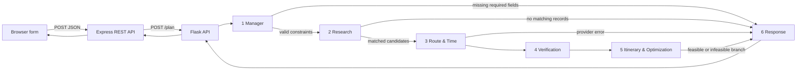

# Tourism six-role workflow

> Architecture reference from the previous implementation pass. For current live-provider status, updated regression cases, and limitations, use the current documents linked in [docs/DOCUMENTATION_INDEX.md](docs/DOCUMENTATION_INDEX.md).

## Architecture

The existing Express application keeps its EJS frontend and REST API. The browser submits plans to `POST /api/v1/tourism-plan`; Express forwards the request to the Flask endpoint `POST /plan`, which invokes a typed LangGraph state machine. No n8n or FastAPI is used. No LLM is needed for schedule arithmetic, dataset lookup, route validation, provenance, optimization, or response formatting.



## Agent contracts

| Role | Input | Output |
|---|---|---|
| Manager | User request JSON | `constraints`, `missing_fields`, `needs_input` when required values are absent or invalid |
| Research | Valid constraints | Dataset records with original IDs, hours, dwell values, and source metadata; no synthetic placeholders and no expansion when there are no matches |
| Route & Time | Candidate records, endpoint coordinates, transport mode | Directed route legs with distance, duration, mode, provider, and retrieval timestamp; `provider_error` if unavailable |
| Verification | Candidate source fields and route metadata | Evidence records classified `VERIFIED`, `STAKEHOLDER_PROVIDED`, or `AI_INFERENCE`; absent sources are never VERIFIED |
| Itinerary & Optimization | Constraints, candidates, route legs | Deterministically selected stops or `infeasible`, reasons for rejected candidates, buffered return time |
| Response | Final workflow state | Stable JSON object; never upgrades failures to success |

### Request example

```json
{
  "user_query": "I want to see silk weaving",
  "interests": ["silk weaving"],
  "city": "Gwalior",
  "date": "2026-10-30",
  "start_time": "10:00",
  "available_minutes": 360,
  "deadline": "18:00",
  "return_location": "Gwalior Fort Main Gate",
  "return_location_coordinates": {"lat": 26.2298, "lng": 78.1733},
  "transport_mode": "auto",
  "budget": null
}
```

### Output example (shape)

```json
{
  "status": "infeasible",
  "trip_summary": {"city":"Gwalior","date":"2026-10-30","start_time":"10:00","return_location":"Gwalior Fort Main Gate","transport_mode":"auto","interests":["silk weaving"],"budget":null,"estimated_cost":null},
  "itinerary_stops": [],
  "travel_estimates": [],
  "evidence": [],
  "rejected_options": [],
  "warnings": [],
  "errors": [],
  "missing_fields": [],
  "estimated_return_time": null,
  "deadline": "18:00",
  "agent_trace": []
}
```

## Setup

Requires Python 3.10+ and Node.js 20+. The workspace virtual environment uses Python 3.14 and is functional.

```powershell
# Terminal 1: existing Express app
npm install
npm start

# Terminal 2: Flask + LangGraph service
cd .\multiagent-engine
py -m venv .venv
.\.venv\Scripts\python.exe -m pip install -r requirements.txt
$env:PYTHONPATH='.'
$env:LANGGRAPH_PORT='8000'
.\.venv\Scripts\python.exe server.py
```

Install development dependencies and run the full pytest suite from the repository root:

```powershell
.\.venv\Scripts\python.exe -m pip install -r .\multiagent-engine\requirements-dev.txt
.\.venv\Scripts\python.exe -m pytest -q .\multiagent-engine
npm test
```

The pytest suite includes a real Gemini integration probe when `GEMINI_API_KEY` is configured. It reports only pass/fail/category; provider error text and credentials are suppressed. LangGraph emits structured JSON events for each node, including request ID, elapsed time, count summaries, and provider/LLM call counts. The API returns the detailed `execution_trace` outside production; production logs retain safe count/timing summaries.

Open `http://localhost:3000`. The form now collects a visit date; city and return point are the configured Gwalior Fort pilot values. For real routes, configure `ROUTING_PROVIDER_URL` (and optional `ROUTING_PROVIDER_API_KEY`) for a JSON POST provider that accepts `{origin,destination,mode}` and returns `{distance_km,duration_minutes,provider,retrieved_at}`. Without it, plans return `provider_error`. Only set `DEMO_MODE=true` for tests/demos; those routes are labelled `synthetic_demo_fixture` and `AI_INFERENCE`.

Set `LANGGRAPH_API_URL` in the Express environment if Flask is not at `http://127.0.0.1:8000/plan`.

## Implemented vs pending

Implemented in code: typed shared state; six agent contracts; conditional graph branches; Flask API; Express REST proxy; direct browser form API call; existing curated JSON integration; exact-match no-result behavior; source classification; time/opening-hours/budget checks; deterministic 25% buffer and final deadline validation; explicit demo-only synthetic routing; structured per-node execution tracing; workflow acceptance and pytest coverage.

Pending environment/data work: configure and exercise a real routing provider; enrich the existing dataset with source URLs/references and date-specific opening schedules; add cost estimates if budget-constrained recommendations are expected. The current dataset has no cost estimates, so a supplied budget causes records without a known cost to be rejected. PostgreSQL/Supabase are not configured in this repository, so the existing JSON data source remains in use.


