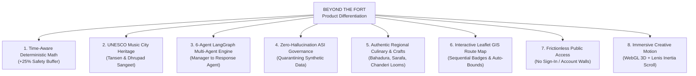

# BEYOND THE FORT — PRODUCT DIFFERENTIATION & UNIQUE VALUE PROPOSITION
**Project:** Beyond the Fort — Discover the Soul of Gwalior  
**Date:** October 31, 2026  
**Auditor:** Tourism Product Strategist & Principal Architect

---

## 1. The Strategic Opportunity

Most online tourism websites fall into one of two traps:
1. **Generic Aggregators (TripAdvisor, MakeMyTrip, GetYourGuide):** Commercial listings driven by commission margins, pushing standardized bus tours with little local cultural depth or time-budget awareness.
2. **Static Government Tourism Portals (Incredible India, State Tourism Boards):** Unstructured walls of text, PDF pamphlets, broken links, and mandatory sign-in walls, lacking interactive route optimization.

**Beyond the Fort** occupies an entirely new, uncrowded category: **Time-Aware, Multi-Agent Cultural Travel Intelligence**.

---

## 2. The 8 Core Differentiators

---

### Differentiator 1: Time-Aware Deterministic Math & +25% Transit Buffer
- **The Competitor Flaw:** Commercial planners calculate straight-line Euclidean distance or optimal GPS driving times, causing tourists to miss trains, return deadlines, or monument ticket cutoffs (05:30 PM Fort gates).
- **Our Advantage:** We enforce a deterministic mathematical inequality:
  $$\text{Travel Time} + 1.25 \times \text{Transit Time} + \text{Dwell Time} \le \text{Available Time Budget}$$
  The non-negotiable $+25\%$ buffer accounts for Lashkar bazaar traffic, steep fort plateau ramps, parking walks, and ticket queues.

---

### Differentiator 2: UNESCO City of Music & Dhrupad Heritage
- **The Competitor Flaw:** Generic travel sites treat Gwalior as merely a 2-hour Fort stop on the Delhi–Agra–Jaipur Golden Triangle.
- **Our Advantage:** We foreground Gwalior’s global status as a **UNESCO Creative City of Music**. The platform highlights Tansen Samadhi, Mohammad Ghaus Tomb, the legendary tamarind tree that sweetens vocal cords, Sarod Ghar (ancestral home of Ustad Hafiz Ali Khan), and ambient classical Tanpura drones directly inside the web experience.

---

### Differentiator 3: 6-Agent LangGraph Multi-Agent Architecture
- **The Competitor Flaw:** Most "AI travel apps" are simple ChatGPT wrapper prompts that hallucinate non-existent attractions and impossible driving times.
- **Our Advantage:** Our system is powered by a real, instrumented **Python LangGraph StateGraph** consisting of 6 specialized autonomous agents:
  1. *Manager Agent* (Geospatial geocoding & time constraints)
  2. *Research Agent* (Curated catalog search)
  3. *Route & Time Agent* (Road transit calculations)
  4. *Verification Agent* (ASI provenance & tariff audits)
  5. *Itinerary & Optimization Agent* (Constraint satisfaction & buffer injection)
  6. *Final Response Agent* (Timeline synthesis)
  Visitors can inspect this pipeline in the live **AI Agents Command Center** tab.

---

### Differentiator 4: Zero-Hallucination Data Governance
- **The Competitor Flaw:** Uncurated datasets mix synthetic test data with real monuments.
- **Our Advantage:** We strictly quarantine 470 synthetic placeholder records and only expose 57 verified candidates (32 ASI protected monuments, 25 verified local businesses). All entry fees, operating hours, and coordinates are audited against official gazettes.

---

### Differentiator 5: Living Bazaars, Culinary & GI-Tagged Crafts
- **The Competitor Flaw:** Tourist sites ignore authentic local street life.
- **Our Advantage:** We integrate real local heritage enterprises: Bahadura Sweets (since 1935), S.S. Kachori Wala, Morena Gajak Bhandar, Sarafa Night Food Street, and direct weaver home studios for GI-tagged Chanderi handloom sarees.

---

### Differentiator 6: Interactive GIS Route Corridor Mapping
- **The Competitor Flaw:** Static static screenshots or embedded Google Maps iframes with no stop sequence.
- **Our Advantage:** Interactive Leaflet map with CartoDB Voyager tiles, custom emerald starting hub star pins, sequential numbered badges ($1, 2, 3, \dots$), dashed polyline corridors, and dynamic auto-fit bounding boxes.

---

### Differentiator 7: 100% Frictionless Public Access
- **The Competitor Flaw:** Forcing account registration and password creation before allowing users to plan a trip.
- **Our Advantage:** Zero public login barriers. Discovery, multi-agent planning, map exploration, and Tansen AI chat are 100% open to every traveler worldwide.

---

### Differentiator 8: Award-Calibrated Creative Web Design
- **The Competitor Flaw:** Flat, generic bootstrap/material UI templates.
- **Our Advantage:** Active Theory-style Three.js WebGL canvas (1,200 particle stars and undulating sandstone terrain mesh), Locomotive-style smooth inertia scrolling, custom magnetic cursor, and royal Scindia typography (`Playfair Display`, `Cinzel`, `Plus Jakarta Sans`).

---

## 3. Product Positioning Summary
Beyond the Fort is not just a guide; it is an **intelligent, culturally authentic travel companion** that guarantees tourists experience the true soul of Gwalior without ever running out of time.
