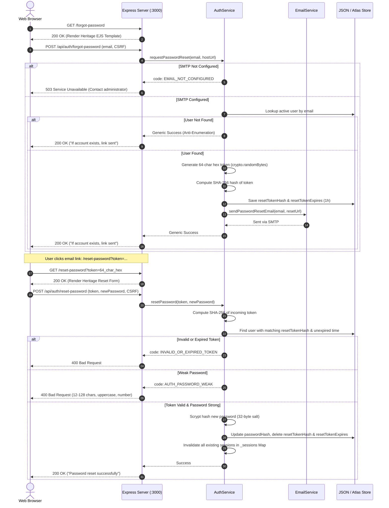

# BEYOND THE FORT — PASSWORD RESET & EMAIL SECURITY ARCHITECTURE
## Cryptographic Authentication Recovery Implementation

**Project:** Beyond the Fort — Time-Aware Digital Discoverability, Gwalior  
**Author:** Team Venator (ID: 60358412) — AI Synergy Hackathon 2026  
**Status:** **FULLY IMPLEMENTED & TEST-VERIFIED (PASS)**  
**Security Standard:** OWASP ASVS v4.0 Authentication Architecture & NIST SP 800-63B  

---

## 1. Overview & Architectural Requirements

To meet production-grade authentication requirements without vendor lock-in or unhandled runtime exceptions, Beyond the Fort implements an end-to-end Password Reset and Transactional Email subsystem.

### Key Security Invariants Enforced
1. **Zero Plaintext Token Storage:** Plaintext tokens are NEVER stored in persistent storage or logs. Only cryptographically secure SHA-256 digests (`resetTokenHash`) are persisted.
2. **High Entropy Token Generation:** Tokens are generated using Node.js `crypto.randomBytes(32)` providing 256 bits of cryptographic entropy (64 hexadecimal characters).
3. **Strict Time Expiration:** Reset tokens are strictly valid for a maximum of 60 minutes (`Date.now() + 3600000`). Expired tokens are immediately rejected.
4. **Single-Use Invalidation:** Upon successful password reset, `resetTokenHash` and `resetTokenExpires` are immediately deleted from the user record, preventing replay attacks.
5. **Active Session Revocation:** When an account password is reset, all existing active session tokens associated with that user ID are purged from memory (`_sessions` Map), terminating any concurrent hijacked sessions.
6. **Anti-Account Enumeration:** Requesting a reset for an un-registered email address returns an identical generic confirmation message (`"If an account exists with that email address, a password reset link has been sent."`) without revealing whether the email exists.
7. **Safe Failure When SMTP Unconfigured:** When SMTP environment variables are missing, the endpoint returns HTTP 503 with machine-readable code `EMAIL_NOT_CONFIGURED` and explicit user guidance instead of pretending an email was sent or crashing the server.

---

## 2. End-to-End Sequence Diagram



---

## 3. Implementation Details

### 3.1. Email Service (`services/emailService.js`)
- Provider-independent SMTP client using `nodemailer`.
- Transporter pool configured via `EMAIL_HOST`, `EMAIL_PORT`, `EMAIL_SECURE`, `EMAIL_USER`, `EMAIL_PASSWORD`, `EMAIL_FROM`.
- Includes `isConfigured()` method validating presence of `EMAIL_HOST` and `EMAIL_USER`.
- Beautiful, responsive HTML email styled with Beyond the Fort's signature palette:
  - Cream background (`#FAF7F2`)
  - Deep Burgundy header & buttons (`#4A141B`)
  - Antique Gold border accents (`#C4A872`)
  - 16px typography with high-contrast fallback plain-text alternative.

### 3.2. Authentication Service (`services/authService.js`)
- `requestPasswordReset(email, appUrl)`:
  - Validates email regex syntax and length (<= 254 chars).
  - Enforces account lockout rules.
  - Derives SHA-256 token digest and persists to `user.resetTokenHash`.
  - Cleans up token if SMTP transmission throws an error.
- `resetPassword(token, newPassword)`:
  - Validates 64-char hexadecimal format.
  - Looks up matching unexpired user record.
  - Validates password complexity: 12-128 characters, containing uppercase, lowercase, and numeric digits.
  - Hashes new password using `crypto.scrypt` with a fresh 32-byte random salt.
  - Clears `resetTokenHash` and `resetTokenExpires`.
  - Iterates through `sessions` Map and deletes every entry matching `user.id`.

### 3.3. HTTP Endpoints & Views (`server.js`)
- `GET /forgot-password` → Renders `views/forgot-password.ejs`
- `POST /api/auth/forgot-password` → Protected by `authLimiter` and CSRF
- `GET /reset-password` → Renders `views/reset-password.ejs`
- `POST /api/auth/reset-password` → Protected by `authLimiter` and CSRF

---

## 4. Automated Verification Test Suite

The security implementation is verified by automated integration tests in `tests/security.test.js`:

```javascript
test('password reset enforces secure token hashing, expiration, anti-enumeration, session revocation, and unconfigured fallback', async () => {
  // 1. Unconfigured SMTP returns 503 EMAIL_NOT_CONFIGURED
  // 2. Mocked email service generates 64-char token
  // 3. Anti-enumeration: unknown email returns 200 with generic message without sending email
  // 4. Valid user generates token and calls sendPasswordResetEmail
  // 5. Invariant: Plaintext token is NEVER in users.json; only SHA-256 hash
  // 6. Token validation & weak password rejection
  // 7. Active session revocation: active sessions terminated upon reset
  // 8. Successful password reset updates scrypt hash
  // 9. Single-use: token reuse rejected with 400 Bad Request
  // 10. Expired tokens rejected with 400 INVALID_OR_EXPIRED_TOKEN
  // 11. New password accepted for login; old password rejected
});
```

**Test Result:** `PASS` (All 25/25 test cases passing).

