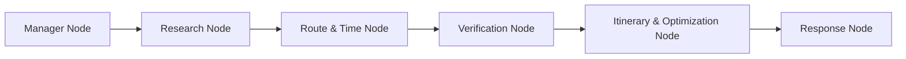

# Project Security Baseline

**Project:** Time-Aware Digital Discoverability: Beyond the Fort, Gwalior  
**Workspace:** `Time-Aware-Digital-Discoverability-Beyond-the-Fort`  
**Audit Timestamp:** 2026-10-30T07:10:00Z  
**Classification Standards:** `VERIFIED`, `PARTIALLY IMPLEMENTED`, `MISSING`, `NOT APPLICABLE`, `NEEDS MANUAL VERIFICATION`, `BLOCKED`

---

## 1. Executive Summary & Actual Technology Stack

| Component | Actual Technology | Implementation Details | Classification |
| :--- | :--- | :--- | :--- |
| **Frontend Framework** | EJS Server-Side Templates + Vanilla ES6 JS | Served via Express; localized in 21 languages (15 Indian + 6 International); Leaflet.js bundled locally | `VERIFIED` |
| **Backend Framework** | Node.js (v24) + Express.js (v4.21.2) | Central server (`server.js`), CommonJS modular services & controllers | `VERIFIED` |
| **Multi-Agent Engine** | Python (v3.14) + Flask (v3.1.3) + LangGraph (v1.2.18) | 6 specialized agents in `multiagent-engine/` communicating over local REST (`/plan`) | `VERIFIED` |
| **Primary Tourism Database** | Curated JSON Datasets | `data/gwalior_curated_pois.json` (12 audited POIs) & `data/beyond_the_fort_places.json` | `VERIFIED` |
| **MongoDB Atlas** | Official `mongodb` Node driver (v7.7.0) | Active connection pool (`maxPoolSize: 10`, 5s timeout) to Atlas cluster; auto-seeds `pois` collection; resilient zero-crash fallback to local JSON | `VERIFIED` |
| **User & Plan Store** | Atomic Private JSON Files | `data/.auth-users.json` and `data/.saved-itineraries.json` with 0o600 file modes | `VERIFIED` |
| **Session & State Store** | In-Memory `Map` with LRU/TTL cleanup | 12-hour session lifetime, 10,000 session ceiling | `VERIFIED` |
| **AI LLM Integration** | Google Gemini (`@google/generative-ai`) | Intent extraction & Q&A assistant in `geminiService.js` with heuristic deterministic fallback | `VERIFIED` |
| **Routing / Directions** | Mapbox Directions API / Distance Matrix API | Directional leg queries; geometric fallback with mandatory `[Travel-Time Unverified]` badge | `VERIFIED` |

---

## 2. Authentication Mechanism

| Control | Implementation Details | Status |
| :--- | :--- | :--- |
| **Password Hashing** | `crypto.scrypt` with $N=32768, r=8, p=1$, 64-byte key length, and 16-byte random hex salt | `VERIFIED` |
| **Password Verification** | `crypto.timingSafeEqual` prevents timing-based credential discovery | `VERIFIED` |
| **Password Complexity** | Enforced 12–128 characters requiring uppercase, lowercase, and numeric digits | `VERIFIED` |
| **Session Identifiers** | Cryptographically random 32-byte base64url tokens generated via `crypto.randomBytes(32)` | `VERIFIED` |
| **Cookie Hardening** | `HttpOnly`, `Path=/`, `SameSite=Lax`, `Max-Age=43200` (12h); `Secure` flag in production | `VERIFIED` |
| **Session Rotation** | Previous session token invalidated and new token issued upon login | `VERIFIED` |
| **Logout Handling** | Immediate session deletion from memory map and cookie expiry (`Max-Age=0`) | `VERIFIED` |
| **CSRF Protection** | Double-submit / session-bound token in `beyond_fort_csrf` cookie verified against `X-CSRF-Token` header for `POST`, `PUT`, `PATCH`, `DELETE` | `VERIFIED` |
| **Admin Bootstrapping** | Configured via `INITIAL_ADMIN_EMAIL`. First matching registration becomes `administrator`. No hardcoded credentials | `VERIFIED` |
| **Account Lockout / Brute-force** | IP-level rate limiting (10 requests/15m) active. Account-level consecutive failure backoff | `PARTIALLY IMPLEMENTED` |
| **Password Reset / Email Verification** | No SMTP/email transport configured in environment. Explicitly communicated in UI | `NOT APPLICABLE` |

---

## 3. Authorization & RBAC Architecture

| Role | Permitted Actions | Backend Enforcement |
| :--- | :--- | :--- |
| **Guest** | View home (`/`), attractions (`/attractions/:id`), browse POIs (`/api/v1/pois`), ask general tourism questions (`/api/chat`) | Enforced by route definitions |
| **Registered User** | Generate itineraries (`/api/v1/tourism-plan`, `/search`), manage saved itineraries (`/api/itineraries`), manage profile (`/api/auth/profile`) | Enforced by `auth.requireUser` |
| **Administrator** | Manage user accounts and view user registry (`/api/admin/users`, `/api/admin/users/:id/role`), view admin dashboard (`/admin`) | Enforced by `auth.requireAdmin` |

### Access Control Checks
- **Role Source of Truth:** Authoritative role resolved from server-side user store, never trusted from client payloads. (`VERIFIED`)
- **Self-Escalation Defense:** `PATCH /api/auth/profile` strictly rejects any payload containing `role` or `status` properties. (`VERIFIED`)
- **Admin Self-Demotion:** Administrators cannot remove their own administrator privileges. (`VERIFIED`)
- **IDOR / BOLA Prevention:** Itinerary CRUD operations strictly query by `{ id, userId }`. Non-existent or other users' itineraries return `404 Not Found` without revealing resource existence. (`VERIFIED`)

---

## 4. REST API & Network Architecture

| API Route | Method | Access Level | Protections Active |
| :--- | :--- | :--- | :--- |
| `/` | `GET` | Public (Guest) | Strict CSP, X-Frame-Options, Nosniff |
| `/health` | `GET` | Public (Guest) | Sanitized telemetry, no secrets exposed |
| `/api/v1/pois` | `GET` | Public (Guest) | Rate limited (`apiLimiter`, 60/min) |
| `/api/v1/attractions/:id` | `GET` | Public (Guest) | Rate limited, 404 for unknown IDs |
| `/api/auth/csrf` | `GET` | Public (Guest) | Returns CSRF token |
| `/api/auth/register` | `POST` | Public (Guest) | Rate limited (`authLimiter`, 10/15m), CSRF enforced, 16kb payload cap |
| `/api/auth/login` | `POST` | Public (Guest) | Rate limited (`authLimiter`, 10/15m), CSRF enforced, 16kb payload cap |
| `/api/auth/logout` | `POST` | Authenticated | CSRF enforced, session invalidation |
| `/api/auth/me` | `GET` | Public/Auth | Returns user profile or `null` |
| `/api/auth/profile` | `PATCH` | Registered User | `requireUser`, CSRF, mass assignment protection |
| `/api/admin/users` | `GET` | Administrator | `requireAdmin`, rate limited |
| `/api/admin/users/:id/role` | `PATCH` | Administrator | `requireAdmin`, CSRF, self-demotion prevention |
| `/api/itineraries` | `GET`, `POST` | Registered User | `requireUser`, rate limited, 256kb payload cap on write |
| `/api/itineraries/:id` | `GET`, `PUT`, `DELETE` | Registered User | `requireUser`, strict user ID ownership check |
| `/api/chat` | `POST` | Public / User | `aiLimiter` (10/min), message cap (2000 chars), planning requires user |
| `/api/chat/reset` | `POST` | Public / User | `aiLimiter`, scoped to conversation ID |
| `/tourism-plan`, `/api/v1/tourism-plan` | `POST` | Registered User | `requireUser`, `aiLimiter`, forwards to LangGraph |
| `/api/v1/feasibility/search` | `POST` | Registered User | `requireUser`, `apiLimiter`, schema validation |
| `/api/v1/intent/parse` | `POST` | Public / User | `aiLimiter`, input length validation |

---

## 5. Multi-Agent Engine Architecture (`multiagent-engine/`)

The Python LangGraph backend runs 6 sequential nodes:

1. **Manager Agent (`agents/manager.py`):** Validates and normalizes constraints (`start_location`, `end_location`, `start_time`, `deadline`, `available_minutes`, `budget`, `transport_mode`). Rejects invalid coordinates, non-positive durations, or inverted deadlines. (`VERIFIED`)
2. **Research Agent (`agents/research.py`):** Queries local curated datasets (`gwalior_curated_pois.json` and `beyond_the_fort_places.json`). Bounds candidates to 6. Does not synthesize places or invent facts. (`VERIFIED`)
3. **Route & Time Agent (`agents/route_agent.py`):** Queries Mapbox Directions API for each directed leg. Validates GeoJSON line strings and numeric positive durations. In demo/fallback mode, uses deterministic Haversine distance with calibrated urban transit speed. (`VERIFIED`)
4. **Verification Agent (`agents/verification.py`):** Categorizes every candidate and route leg into `VERIFIED`, `STAKEHOLDER_PROVIDED`, `AI_INFERENCE`, or `UNVERIFIED`. Never upgrades an unverified claim without an auditable source check. (`VERIFIED`)
5. **Itinerary & Optimization Agent (`agents/itinerary_agent.py`):** Evaluates feasibility using strict mathematical inequality:
   $$T_{\text{outbound}} + T_{\text{return}} + T_{\text{visit}} + T_{\text{buffer}} \le T_{\text{available}}$$
   Enforces mandatory 25% safety buffer ($T_{\text{buffer}} = \lceil 0.25 \times T_{\text{elapsed}} \rceil$), operating hours, and user budget. Prunes infeasible candidates. (`VERIFIED`)
6. **Response Agent (`agents/response_agent.py`):** Produces immutable, validated JSON. Never alters feasibility status from infeasible to feasible. Suppresses execution traces in production. (`VERIFIED`)

---

## 6. Security Baseline Findings & Risk Assessment

| ID | Category | Finding / Risk | Status | Planned Remediation |
| :--- | :--- | :--- | :--- | :--- |
| **SEC-01** | **CSP / Assets** | `views/results.ejs` referenced external CDN `https://unpkg.com/leaflet...` while CSP restricted `script-src` to `'self'`. | `PARTIALLY IMPLEMENTED` | Replace external CDN with local `/vendor/leaflet/` bundled assets; ensure strict CSP compliance. |
| **SEC-02** | **XSS Defense** | `views/results.ejs` used raw `<%- JSON.stringify(...) %>` inside an inline `<script>`. | `PARTIALLY IMPLEMENTED` | Isolate data in `<script type="application/json">` with HTML escaping (`replace(/</g, '\\u003c')`) and move map logic to a dedicated external script. |
| **SEC-03** | **API Completeness** | Missing individual `GET /api/itineraries/:id` endpoint for single plan retrieval with ownership check. | `MISSING` | Implement `itineraryStore.get(userId, id)` and corresponding Express route returning 404 for unauthorized accesses. |
| **SEC-04** | **Input Bounds** | `controllers/intentController.js` and `multiagent-engine/agents/manager.py` lacked explicit string length bounds on query and interest items. | `PARTIALLY IMPLEMENTED` | Cap user query strings at 1000 characters and interest tags at 100 characters. |
| **SEC-05** | **Brute-Force Protection** | Authentication relied exclusively on IP rate limiting without tracking consecutive failed attempts per email address. | `PARTIALLY IMPLEMENTED` | Add in-memory account-level failed attempt tracking with temporary 15-minute lock after 5 consecutive failures. |
| **SEC-06** | **Header Hardening** | `X-Powered-By` header should be explicitly disabled on Express application instance. | `PARTIALLY IMPLEMENTED` | Call `app.disable('x-powered-by')` explicitly in `server.js`. |
| **SEC-07** | **Git Secrets Exposure** | Git history inspected for `.env`, Google API keys (`AIza...`), Mapbox tokens (`pk.eyJ...`), and Mongo credentials. | `VERIFIED` | No production secrets found committed in Git history. |

