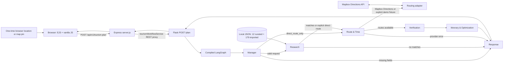

# Current Architecture

## Active planner

The diagram follows `server.js`, `services/tourismWorkflowService.js`, `multiagent-engine/server.py`, `multiagent-engine/graph.py`, and the role functions in `multiagent-engine/agents/`. The Mermaid edge from itinerary to response covers both feasible and infeasible outcomes; the graph has no separate terminal itinerary node.

## Components

- **Express** serves EJS pages and the legacy feasibility/intent APIs. `/api/v1/tourism-plan` proxies planner requests to Flask. The process health route does not check Flask or providers.
- **Flask** exposes `/plan`, `/health`, and `/attractions`. `/plan` invokes the compiled LangGraph and adds an execution trace in non-production mode.
- **LangGraph** registers six deterministic functions. `llm_calls` is zero for every node. Conditional edges skip research on missing input or when `direct_route_only=true`, skip routing on empty attraction matches, and skip verification/itinerary when routing fails.
- **Data** is local JSON. Express loads the 12 curated records; the Flask Research node loads those plus 179 supplemental imported listings. MongoDB is not connected by the application.
- **Locations** are selected in the active EJS page using a one-time browser geolocation action, Leaflet map pins, or manually entered coordinates. Typed place names are not geocoded; no geocoding provider is configured. Locations remain in the current tab's session storage with the itinerary.
- **Routing** calculates directed legs through candidate stops to the selected destination. It calls Mapbox Directions for each required direction when configured; no external provider is called in explicit demo mode. Route geometry is displayed only when the provider returns a valid LineString.
- **Gemini** is a separate server-side Node service used for chat question answering and the legacy intent/feasibility path. It is not called by LangGraph. A timeout is returned as an error; the service does not fabricate an answer.
- **Frontend state** for the itinerary lives in the current browser tab's `sessionStorage`; there is no user account or server-side itinerary persistence.

## Not implemented

No active n8n or FastAPI flow, MongoDB adapter, relational database, persistent user itinerary store, external place-source verifier, date-specific calendar, or timezone-aware/overnight scheduler exists in the audited request path.
