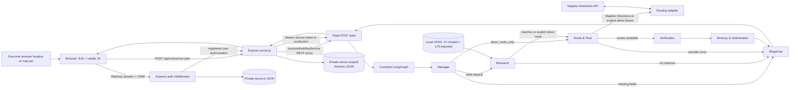

# Current Architecture

## Active planner

The diagram follows `server.js`, `services/tourismWorkflowService.js`, `multiagent-engine/server.py`, `multiagent-engine/graph.py`, and the role functions in `multiagent-engine/agents/`. The Mermaid edge from itinerary to response covers both feasible and infeasible outcomes; the graph has no separate terminal itinerary node.

## Components

- **Express** serves EJS pages and REST APIs. It creates password-hashed accounts, opaque server-side sessions, role checks, CSRF validation, basic rate limits and safe security headers. Tourism planning and legacy feasibility are registered-user endpoints; public chat questions, POI details, and the separate intent parser remain rate-limited public routes. The process health route does not check Flask or providers.
- **Flask** exposes `/plan`, `/health`, and `/attractions`. `/plan` invokes the compiled LangGraph and adds an execution trace in non-production mode. In production, planner POSTs require the shared Express service bearer token.
- **LangGraph** registers six deterministic functions. `llm_calls` is zero for every node. Conditional edges skip research on missing input or when `direct_route_only=true`, skip routing on empty attraction matches, and skip verification/itinerary when routing fails.
- **Data** is local JSON. Express loads the 12 curated records; the Flask Research node loads those plus 179 supplemental imported listings. MongoDB is not connected by the application.
- **Locations** are selected in the active EJS page using a one-time browser geolocation action, Leaflet map pins, or manually entered coordinates. Typed place names are not geocoded; no geocoding provider is configured. Locations remain in the current tab's session storage with the itinerary.
- **Routing** calculates directed legs through candidate stops to the selected destination. It calls Mapbox Directions for each required direction when configured; no external provider is called in explicit demo mode. Route geometry is displayed only when the provider returns a valid LineString.
- **Gemini** is a separate server-side Node service used for chat question answering and the legacy intent/feasibility path. It is not called by LangGraph. A timeout is returned as an error; the service does not fabricate an answer.
- **Authentication** uses scrypt password hashes and 256-bit random opaque session IDs stored in the Express process; the browser receives HttpOnly, SameSite=Lax cookies (Secure in production). Mutating same-origin routes validate a session-bound CSRF cookie/header pair. Session state expires after 12 hours and is lost on restart; multiple Express processes do not share sessions.
- **Account and itinerary persistence** uses private JSON files separate from public tourism datasets. The API scopes every saved-plan lookup, update, and deletion to the session user ID. Browser `sessionStorage` still supports the currently displayed itinerary/map; saved plans also live server-side per account.

## Not implemented

No active n8n or FastAPI flow, MongoDB adapter, relational database, email delivery/reset service, external place-source verifier, date-specific calendar, or timezone-aware/overnight scheduler exists in the audited request path. The JSON persistence model is intended for a single process and requires durable private storage and backups in production; it is not a substitute for a transactional multi-instance database.
