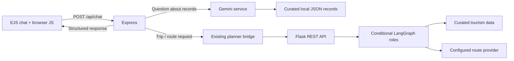

# Tansen AI Chatbot Architecture

Updated: 2026-10-30

## Active design

Tansen AI is a page in the existing Express + EJS site at `/chat`. Browser code is plain JavaScript; the active chat does not use the separate `new_style` React prototype. The browser calls Express `POST /api/chat`. Express routes ordinary tourism questions to the existing server-side Gemini service, which receives a restricted view of the same curated attraction records used by the site. It routes travel plans to the existing Express-to-Flask bridge and LangGraph workflow. No second AI backend or n8n workflow is involved.

The LangGraph graph has six deterministic roles: Manager, Research, Route & Time, Verification, Itinerary & Optimization, and Final Response. Conditional graph edges skip roles when required inputs or provider results are missing. These roles do not call Gemini; Gemini is only used for grounded question answering. The planner calculates time and deadline feasibility deterministically and returns structured route, visit, evidence, and warning data.

## Conversation and location handling

Express issues a dedicated `beyond_fort_chat` HttpOnly, SameSite=Lax cookie for chat state, separate from the authentication cookie. Conversation history is isolated by that cookie and conversation ID, capped at 20 messages per conversation, and expires after 12 hours of inactivity. The in-memory map is bounded to 10,000 active sessions; expired sessions are removed when a session is accessed. Restarting Express clears all chat history. Tourism questions remain public; planning intent requires a registered user. Chat POSTs require CSRF validation.

The browser asks for geolocation only after the visitor presses **Use my current location**. A typed address or place name is not geocoded: the visitor needs coordinates from manual entry or the existing planner's map pin. Location is sent to the planner only as part of a requested plan; the configured route provider receives coordinates needed for directions. The current tab holds the active map view in `sessionStorage`; successfully generated itineraries are also saved to a private local JSON file scoped to the registered user, expire after 365 days, and can be deleted from Account. This file stores the submitted location coordinates and requires restricted access and backups.

## Evidence and failures

Gemini receives IDs, names, categories, descriptions, addresses, evidence status, source references/URLs, available hours, and dwell-time fields from the existing records. The prompt requires it to disclose missing evidence and forbids invented facts. Provider failures return HTTP 503. Planner errors and missing inputs remain structured statuses; the chat does not present an unavailable/infeasible planner result as a successful itinerary. A route geometry or coordinate is rendered only when returned by the planner.

See [CHATBOT_API.md](CHATBOT_API.md), [CHATBOT_TEST_REPORT.md](CHATBOT_TEST_REPORT.md), [LOCATION_AND_ROUTE_PLANNING.md](LOCATION_AND_ROUTE_PLANNING.md), and [DEPLOYMENT_GUIDE.md](DEPLOYMENT_GUIDE.md).
